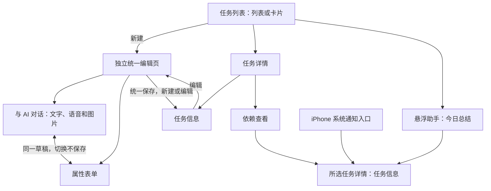

# 任务提醒工具需求

- **工具标识：** `reminders`
- **状态：** 首版实现基线，完整功能尚未实现
- **版本：** 1.4
- **更新日期：** 2026-10-19
- **所属应用：** Venus Tools（iPhone 与 Apple Watch）

本文是任务提醒工具的唯一正式需求入口。本次只更新文档，不修改应用代码。用户于 2026-10-19 授权助手自行确定此前未定规则，先形成可实现的首版，再根据实际体验调整。因此本文的默认值和行为均为当前实现基线，无需逐项等待确认；它们属于用户授权下的设计选择，不表示用户逐条指定，也不表示已经实现或经过性能实测。

| 版本 | 日期 | 内容与依据 |
| --- | --- | --- |
| 1.0 | 2026-10-16 | 整理用户提出的功能，补充是否完成、系统通知与 Apple Watch 方向 |
| 1.1 | 2026-10-19 | 根据用户授权，确定原先全部未定项；新增决策编号、选择理由、验收目标与后续调整规则 |
| 1.2 | 2026-10-19 | 按用户补充，将新建与编辑统一为独立页面，设置“与 AI 对话 / 属性表单”两个标签页，明确共享草稿、保存和返回规则 |
| 1.3 | 2026-10-19 | 按用户补充，在同一 AI 对话中加入图片；明确选图、识图、混合输入、草稿保留及本机图像处理方案 |
| 1.4 | 2026-10-19 | 按用户补充，任务 AI 对话与今日总结支持配置所用模型；具体配置规则由 `setting.md` 统一说明 |

## 1. 目标与范围

把生活中的琐事、计划、目标和想做的事统一记录为任务。用户可以用文字、语音和图片表达，由模型整理为结构化属性，也可以直接手动编辑；随后查找任务、查看依赖、接收提醒，并让悬浮助手总结今天要完成的任务。

### 1.1 已明确的功能

- 任务属性包含标题、概要、Markdown 具体内容、添加时间、执行时间、`key:value` 标签、前置任务、任务等级和是否完成。
- 从任务列表进入独立的新建页面，通过文字、语音或图片与 AI 对话添加，支持混合输入和继续追加信息，模型整理后允许属性缺省；也可切换属性表单直接填写。
- 保存新任务后进入该任务详情页。
- 任务提供列表与卡片网格两种展示方式。
- 支持模糊查找、智能查找，以及时间排序、标签、任务等级等过滤。
- 新建和编辑使用同一套独立编辑页面，页面内有“与 AI 对话”“属性表单”两个标签页；AI 对话同时支持文字、语音和图片。
- 详情页保留“任务信息”“依赖查看”两个页签；在任务信息页选择编辑后进入统一编辑页，不在详情内嵌另一套完整编辑表单。
- 模型整理与手动编辑作用于同一份任务数据，可以按修改先后相互覆盖。
- 依赖页展示完整依赖链，点击任务节点进入对应任务详情的任务信息页签，再由编辑入口进入统一编辑页。
- 提供可拖动的悬浮助手按钮，用于总结今天要完成的任务。
- 首版需要到执行时间主动发送系统通知，并沿用项目的 Apple Watch 提醒方向。
- 任务增加“是否完成”，默认未完成。
- 任务 AI 对话和今日任务总结使用的模型均支持配置；配置入口、可选模型、默认值及管理规则由 `setting.md` 统一说明，本文只声明两项能力应使用已配置的模型。

### 1.2 沿用项目约束

- iPhone 是完整任务管理的主要入口；Apple Watch 承接提醒查看、接收提醒和完成操作。
- 沿用项目已有的本机 AI 方向：语音转写、图片文字识别与图像理解、属性整理、智能查找和今日总结在所需模型就绪后由 iPhone 本机处理，任务文本、录音和图片不上传云端模型服务。
- 属性抽取、智能检索与总结按第 12 节的固定目标验收；达不到时记录实测差距并按第 15 节调整，不能静默放宽要求。
- 页面与任务规则、数据保存、AI、通知、同步分开组织，以便后续替换视觉样式和增加其他工具。

项目级背景见 [应用需求](../../需求.md)，共用 AI 能力见 [智能助手工具需求](ai-assistant.md)。文字与语音原有选型不变，图片新增本机文字识别和视觉语言模型，详见第 5.4 节；不能把文字模型视为天然具备识图能力。

### 1.3 首版范围边界

首版不提供重复任务、周期提醒、提前提醒、批量拆分目标、多人协作、账号系统、业务层 iCloud/云端同步、付费能力或第三方日历集成。它们属于明确排除的范围，不是阻塞开发的问题。任务保存在 iPhone 本地，并向配对 Watch 同步所需数据；设备系统备份遵循用户的系统配置。

最低系统沿用 iOS 17、watchOS 10；手动任务管理面向兼容这些系统的设备。本机 AI 的首版验收设备为 iPhone 16，其他设备不承诺同等速度；模型无法运行时保留全部手动功能。其他工具的现有演示不纳入本工具的正式交付验收。

## 2. 文档与代码位置

- 本工具需求：`docs/tools/reminders.md`。
- 工具目录与新增规范：`docs/tools/README.md`。
- 后续本工具代码归属：`VenusTools/Tools/Reminders/`，按 iPhone、Watch 和两端共用内容组织。
- 新工具以同级文档和同级工具代码目录横向添加，不把所有工具堆进同一个页面或业务文件。
- 本次不创建业务代码、不迁移现有原型文件、不调整 Xcode 工程；迁移在正式开发时进行。

## 3. 任务数据

### 3.1 用户可见属性

| 属性 | 含义与编辑方式 | 缺省与校验 |
| --- | --- | --- |
| 标题 | 一句话说明任务；可由模型整理或手动设置 | 保存时必填，去除首尾空白后 1～100 字符；输入充分时模型可概括，否则保留草稿并提示补充 |
| 概要 | 对任务的简短介绍，与具体内容分开 | 默认空，最多 300 字符 |
| 具体内容 | 保存 Markdown 原文，支持阅读渲染与编辑原文 | 默认空，最多 20,000 字符；切换展示方式不丢失 Markdown 内容 |
| 添加时间 | 任务的添加日期与时间；默认自动填入，也支持手动调整 | 默认当前时间；用于添加时间排序，不用于判断哪次修改更新 |
| 执行时间 | 三种状态：未安排、仅日期、精确日期时间 | 默认未安排；仅日期当天 09:00 提醒；时间和时区规则见第 5、10 节 |
| 标签 | `key:value` 形式，例如 `领域:生活`、`地点:家` | 默认空；同一 key 一个 value；每任务最多 20 项，key 为 1～20 字符，value 为 1～50 字符 |
| 前置任务 | 当前任务依赖的已有任务，可有多个 | 默认无；引用任务身份，不只存标题；不能引用自身或形成循环 |
| 任务等级 | 表达任务的重要程度，和完成状态分开 | “未指定 / 低 / 中 / 高”四档，默认未指定；不另设紧急程度 |
| 是否完成 | 用户标记任务是否已经完成 | 默认未完成；支持切换为已完成和恢复为未完成 |

所有上述属性都应在详情的“任务信息”页签展示，并可进入统一编辑页的“属性表单”手动设置，包括添加时间。两个编辑标签页共享同一份草稿；列表、卡片、依赖图、今日总结、通知与 Watch 同步均读取同一份已保存数据，不能提前读取尚未保存的草稿。

### 3.2 支撑功能所需的内部信息

这些信息用于保证任务身份与修改一致，不要求用户填写：

- 稳定任务标识：标题修改后仍能找到同一个任务，依赖和通知不会失去关联。
- 最近更新时间与数据版本：用于判断修改先后，以及检测模型处理期间发生的编辑。
- 字段的最近修改信息：避免旧模型结果覆盖用户较新的手动调整。
- 完成时间：每次从未完成改为已完成时记录当前时间；恢复未完成时清空当前完成时间，旧值保留在最近修改记录中，不另建无限完成流水。
- 通知与同步状态：区分待安排、权限未授予、待同步、失败等状态。

### 3.3 输入、草稿和历史保留

- 每条任务保留最近 20 个已保存版本的属性快照及修改时间、来源；不保存无限历史，也不把模型提示词和原始录音写入版本快照。
- 文字、语音转写、图片本机副本与缩略图、识别结果、当前对话、属性值、未解决的字段冲突和当前标签页共同组成一份草稿，在保存前存于本机，处理失败后可继续编辑；新建入口和每个编辑中的任务各保留一份草稿，距最后编辑 7 天后连同图片副本清理。打开时提示恢复或放弃，7 天期限在草稿入口可见。
- 任务保存或用户放弃草稿后删除对应原始输入、转写、图片副本与缩略图、本轮对话、冲突候选和模型中间结果；任务中用户确认保留的文字正文不受影响，不永久保存一份独立聊天记录。清理仅作用于应用副本，不删除相册原图。
- 录音仅供本次转写临时使用，确认转写或取消录音后删除；转写失败时在当前会话内允许重试，异常退出遗留的临时录音在下次启动时清理。
- 单次智能输入最多 2,000 字符，单段录音最多 2 分钟；到录音上限自动停止并进入转写。转写超过文字上限时保留全文供用户分段处理，不静默截断。
- 每条对话消息最多 3 张静态 JPEG、PNG 或 HEIC 图片，单张原文件不超过 20 MB、解码像素不超过 4,800 万；一份草稿最多 10 张。选取后展示缩略图，可预览、旋转/裁剪、移除和重新选取；超限时提示调整，保留已有输入。首版不接收视频、动态图或 PDF。
- 图片是对话整理材料，首版不新增永久图片附件属性；保存后保留从图片整理且已确认的任务文字和属性，图片不会自动嵌入 Markdown 或同步到 Watch。
- 超过任一字段上限时保留输入、指出超出字段并阻止保存；不截断已保存内容。字符按用户可见字符计数。

## 4. 页面结构与主要流程

| 页面或区域 | 主要内容 | 入口与去向 |
| --- | --- | --- |
| 任务列表页 | 列表/卡片切换、查找、过滤、排序、新建入口 | 工具主入口；选择任务后进入详情，选择新建后进入统一编辑页 |
| 统一编辑页（新建 / 编辑） | 共用页面布局、交互和顶部返回/保存操作，内部为“与 AI 对话 / 属性表单”两个标签页 | 新建从列表进入；编辑从任务信息页进入；两种入口均打开独立新页面 |
| 编辑页：与 AI 对话 | 连续对话，文字、语音和图片混合输入，可修正转写/图片识别文字、预览图片和字段变更、选择冲突结果 | 与属性表单切换时保留同一份草稿、图片与本轮对话 |
| 编辑页：属性表单 | 手动设置第 3 节全部属性，Markdown 原文编辑和阅读预览 | 表单修改同步到共享草稿，AI 下一轮基于最新草稿理解 |
| 任务详情：任务信息 | 已保存属性、Markdown 阅读、编辑入口、完成/恢复快捷操作 | 从列表、依赖节点、总结结果或通知进入；选择编辑打开统一编辑页 |
| 任务详情：依赖查看 | 当前任务及完整上下游依赖关系 | 点击节点进入对应任务详情的“任务信息”页签 |
| 悬浮助手 | 今日任务总结、任务入口、刷新 | 从悬浮按钮打开，保留当前浏览上下文 |

### 4.1 统一编辑页

- 新建和编辑均以导航进入独立整页，不使用底部新增表单，也不在详情中就地展开编辑器。区别仅为页面标题“新建任务 / 编辑任务”和初始草稿：新建使用缺省值，编辑加载该任务的已保存属性。
- 两种入口默认都打开“与 AI 对话”，无需先与 AI 交互即可切到“属性表单”；恢复草稿时恢复上次标签页。历史版本恢复是带预览目的的特殊入口，在相同页面默认打开属性表单，不使用另一套编辑器。
- 标签页固定名为“与 AI 对话”“属性表单”，文字、语音和图片是同一对话标签页的输入方式，不再各自占用标签页；支持同一条消息附图并输入文字，也可先发图再用文字或语音追加说明。
- 两个标签页实时共享草稿。标签切换不保存任务、不要求确认、不清空内容、不新建任务；属性表单中的完成开关也只修改草稿。切到表单可立即看到模型已合并的属性，切回对话保留消息并以最新表单属性作为后续上下文。
- 模型返回通过校验的结果后，将无冲突字段合并到共享草稿并展示变更预览；涉及字段冲突时默认保留当前草稿值，由用户选择。合并草稿不等于保存任务，通知、Watch 和修改历史均不因合并而更新。
- 标签切换不取消正在进行的转写、图片识别或分析；录音中切换标签时先结束录音再继续转写。顶部显示处理状态，用户可取消。开始保存或离开页面时停止在途请求，丢弃迟到结果；保存使用当时已合并的草稿，若尚有分析未完成，先说明其结果不会纳入本次保存。

### 4.2 保存和返回

- 两个标签页共用页面顶部的“保存”操作；保存校验与缺省规则完全一致。新建可全程只用表单，编辑也可全程只用 AI 对话。
- 新建保存成功后用该任务详情替换编辑页面，默认打开任务信息页签，返回时到原列表；不把新建页留在返回路径中。
- 编辑保存成功后退出编辑页并返回原任务详情的任务信息页签，显示新数据，不重复叠加详情页面。保存失败保留页面、对话和草稿并提示原因。
- 详情保留“任务信息 / 依赖查看”两个页签，与编辑页的两种模式分别属于不同页面。修改记录、回收站和助手仍可用弹层；历史恢复最终通过统一编辑页保存。

原始描述中的编号按以下含义归一：第 4 项是任务列表，第 6 项是详情容器，第 7/8 项原指查看与编辑、依赖查看。按 1.2 补充，原“查看与编辑”拆为详情中的任务信息展示和独立统一编辑页；依赖查看仍在详情中。“两种方式生成的属性相互覆盖”指 AI 对话与属性表单作用于同一任务草稿。

## 5. 统一编辑页的对话、表单与继续补充

### 5.1 新建任务

1. 用户在列表页选择新建，导航进入统一编辑页，默认打开与 AI 对话标签页。
2. 可用文字、语音和图片连续对话；语音先转成可编辑文本，图片可从相册选择、相机拍摄或剪贴板主动粘贴。用户可修正转写和图片识别结果，再继续补充说明。
3. 模型从当前输入与最新共享草稿中整理属性，有明确依据才填入，缺少的信息允许缺省；无冲突结果合并草稿并列明新增、替换和清空的字段。
4. 用户可继续用文字、语音或图片补充，例如发活动海报后说明“提醒我参加这个活动”，也可随时切到属性表单填写或修正；两个标签页反映同一份草稿。
5. 用户不使用 AI 也可在属性表单填完后直接保存。模型合并结果、对话追加和标签切换均不自动创建任务。
6. 用户点击页面统一保存，成功后创建一条任务并进入该任务详情的任务信息页签；保存失败保留输入、对话和草稿。

首版一次新增流程只创建一条任务。一句话包含多个独立事项时，展示“一次保存为一个任务”的提示，将事项保留为该任务的 Markdown 清单；用户可返回编辑或分别新增，不自动批量拆分。

### 5.2 对已有任务继续补充

- 用户在任务详情的信息页点击编辑，导航进入与新建完全相同的统一编辑页，以当前任务已保存数据初始化草稿，明确显示正在编辑哪一条任务。
- 与新建一样，可以在与 AI 对话标签页用文字、语音或图片追加，也可以直接使用属性表单。打开编辑页或修改草稿不产生新任务；统一保存后只更新该任务，保持任务标识不变，并返回原任务详情。
- “追加”和“替换”根据表达处理：例如“内容再加一句……”追加内容，“把具体内容改为……”替换内容；语义不清时展示待应用结果，不静默清空旧值。
- 用户明确要求清空某个字段时才清空；模型没有输出的字段保持草稿当前值，不能回退到进入页面时的旧值。
- 标签的新增、替换和删除，以及前置任务的增减，均需表达为明确变更，不能把“未提及”理解为删除。

### 5.3 抽取与歧义处理

- 相对日期根据输入时的设备本地日期和时区解释，并显示最终日期；例如在 2026-10-19 输入“明天下午三点”，结果显示为 2026-10-20 15:00。星期以周一为一周开始，“周五”取今天或之后最近的周五，“下周五”取下一自然周的周五。
- 输入明确日期但未说时刻时生成仅日期任务；“明天下午”“周末有空时”等无法唯一确定执行时刻或日期的表达，保留为正文中的时间意图，执行时间先留空，由用户在结果中选择日期或时刻，不擅自补成 09:00。
- “周末”“有空时”等无法确定的时间不强行推测成精确时刻；保留原意并提示补充。
- 前置任务必须关联已有任务。名称重名或无法唯一匹配时提供候选，不仅凭相似标题自动关联；找不到时提示选择或后续创建。
- 不允许模型凭空创建前置任务、捏造执行时间，或因为“想做完”就把任务标记为已完成。
- “已经完成”等明确表达可以作为完成属性的待应用变更，并随结果一同展示。
- 首次使用模型、模型未就绪、处理失败和权限被拒绝时显示可理解的状态；仍允许手动录入和编辑任务。
- 等级仅在用户明确表达重要程度时设置，否则保持未指定；标签可依据输入提出建议，随整理结果一起核对。标签首尾空白去除，key 按不区分英文字母大小写识别；同 key 新值替换旧值，显示形式保留用户最后确认的写法。不建立单独标签字典，只提供已有 key/value 的输入补全。
- 正文超过 2,000 字符时不送入整体重写；页面说明智能补充仅依据本次输入修改所提及字段，正文可追加，整体替换须手动编辑。任务总结使用标题、概要和结构化属性，不需要向模型传入全部长正文。
- AI 对话属性整理调用设置中配置的对话模型；配置项和可选模型范围以 `setting.md` 为准，本文不限定设置页面样式或模型清单。

### 5.4 图片输入与理解

- **交互：** 对话输入区提供图片入口，包含相册选择、拍摄和主动粘贴；选取前不读取整个相册或剪贴板。拍摄时请求相机权限，拒绝后仍可选择已有图片、输入文字/语音或切表单；取消选图不清空已写内容。
- **理解范围：** 同时支持截图、海报、清晰纸面文字的提取，以及日常物品/场景照片的内容理解。例如活动海报可整理活动与时间；物品照片加“记得维修它”可整理待办。无文字照片不能一律报成没有可用输入，不把识图功能缩为仅文字识别。
- **本机流程：** Apple Vision 提取可编辑文字，`mlx-community/Qwen2-VL-2B-Instruct-4bit` 通过 MLX Swift 的 MLXVLM 处理图像内容；综合用户说明、图中文字、可见场景及最新草稿，再交由现有文字整理能力生成属性。文字模型 `Qwen3-1.7B-4bit` 不直接接收图片。Vision 的识字能力及 MLXVLM 对该视觉模型的支持分别见 [Apple 文档](https://developer.apple.com/documentation/vision/vnrecognizetextrequest)和 [MLXVLM 官方说明](https://github.com/ml-explore/mlx-swift-lm/blob/main/Libraries/MLXVLM/README.md)。
- **资源：** 新视觉模型由用户单独下载并缓存，沿用 Wi-Fi、蜂窝确认和删除策略，不随安装包预置。多张图逐张处理，视觉推理输入副本长边最多 1,280 像素，OCR 可使用原图；三类大模型不同时常驻推理内存，按阶段加载和释放。首版验收仍以 iPhone 16 为准，真实内存与速度按第 12 节验证，不能将官方可加载示例写成手机已达标。
- **可核对结果：** 对话中显示每张图的缩略图、识别文字、内容摘要及关联字段变更。文字提取可修正；看不清的数字、日期、对象或用户意图保留不确定性，通过对话补充或表单修正，不凭照片补出不存在的时间、等级或依赖。
- **时间与意图：** 图片中的“明天/下周”等相对日期不能直接按今天解释，除非用户给出图片所指的参考日期；缺少年份或时区且无法唯一确定的时间先留空并保留原意。照片元数据时间、状态栏时钟和订单创建日期不能自动充当执行时间；活动日、截止日等按用户表达区分。图片中的“已完成”或操作指令不等于用户要求更改当前任务，不能仅据图中文字自动勾选完成、删除或修改其他任务；继续遵循当前任务、共享草稿及统一保存规则。
- **多图和长度：** 多图按消息顺序显示并标明来源，内容冲突时展示差异，不按最后一张图静默覆盖。送入一次文字整理的用户说明、转写、OCR 和识图摘要合计最多 2,000 字符；超出时保留全部已识别文本，提示选择相关段落、裁取区域或分轮补充，不静默截断。
- **失败与回退：** 权限拒绝、格式/大小超限、模糊图、解码失败、云端照片尚无本机副本、模型未下载、内存不足或超时均显示对应原因，保留已有草稿和仍可用的图片，可重新选取或重试。视觉模型不可用时，允许用户明确选择“仅提取图中文字”继续，但必须标明没有理解场景，不能把文字识别回退当作完整识图成功，也不能静默上传云端。模型已缓存且图片已在本机时，断网仍可处理。
- **草稿与修订：** 切换属性表单不丢图片、识别结果与对话。识别中的图片被移除、替换或旋转/裁剪，或用户修正其识别文字时，均增加输入修订并使相关旧请求失效，迟到结果不能再回写；后续表单修改仍受草稿字段修订保护。已合并的属性不会因移除图片自动回滚，对话说明这一点，用户可用表单或新消息明确更正。
- **保留边界：** 图片副本随草稿保存至多 7 天；保存、放弃、删除对应草稿或到期时清理副本、缩略图及识别中间结果，不改变相册原图。图片不作为模型训练材料，不上传模型服务，不纳入已保存任务历史或 Watch 同步。

## 6. 同一份数据与覆盖规则

### 6.1 基本原则

- AI 对话和属性表单是同一编辑页的两种模式，共用草稿和字段修订信息，不维护两份独立属性。
- 草稿内部按实际修改先后处理覆盖；持久化任务按成功保存的字段版本处理覆盖，不以可编辑的“添加时间”判断。模型返回时间不能单独作为更新意图较新的证据。
- 对同一个字段，用户较晚的明确修改可以覆盖较早值；无关字段不受影响。模型下一轮请求使用最新草稿，避免引用旧对话中的过期属性。
- 编辑页只有统一保存才提交任务、产生修改记录、更新通知和 Watch；标签切换与草稿本机暂存都不触发这些副作用。列表等页面始终显示已保存任务。

### 6.2 模型处理期间发生编辑

模型开始整理时记录所依据的任务基础版本与草稿字段修订。结果返回后，同时检查已保存任务的外部更新和草稿中的未保存修改；不能只检查持久化版本：

- 未发生后续修改：合并本次明确变更到草稿并展示预览。
- 同一字段已在属性表单或对话中后续修改：旧结果不得静默覆盖，展示差异，默认保留当前草稿值；用户可逐字段选择使用模型结果。
- 不同字段发生修改：保留新的手动值，将无冲突字段合并到同一草稿。切换标签或尚未点击保存不影响这项保护。

用户主动选择冲突结果后，该操作才成为一次新的草稿修改。无冲突字段和冲突选择都在保存前可查看，点击统一保存后才提交任务；模型返回不能直接提交部分字段。保存前再次核对基础版本：Watch 或其他快捷操作改过但草稿未涉及的字段，沿用最新已保存值；同字段都有明确变更时展示差异，默认保留已保存新值，用户选择后再保存，避免全量旧草稿覆盖外部更新。

### 6.3 修改记录与恢复

详情提供“修改记录”入口，展示最近 20 个版本；选择“恢复为新版本”后进入相同的统一编辑页，以所选历史属性初始化草稿，默认打开属性表单并显示与当前版本的差异。用户仍可切到 AI 对话修改，再统一保存；打开历史预览本身不改变任务。保存前检查必填、长度和依赖有效性，无效依赖须移除；恢复不回拨内部版本和真实更新时间，完成时间按本次状态切换处理，通知按保存结果重新安排。首版不增加额外的全局撤销栈。

### 6.4 示例

| 顺序 | 操作 | 结果 |
| --- | --- | --- |
| 1 | 与 AI 对话中用语音创建“明天买牛奶”，统一保存 | 所有页面显示已保存时间 |
| 2 | 编辑页属性表单把执行时间改为后天，统一保存 | 新时间覆盖语音生成值 |
| 3 | 与 AI 对话补充“改成周六上午十点”，核对后统一保存 | 新时间覆盖手动值，其他字段保持原样 |
| 4 | 文字只补充标签 `地点:超市`，统一保存 | 增加标签，执行时间不改变 |
| 5 | 模型处理中切到属性表单，手动改时间但未保存 | 旧模型结果不能覆盖较新的草稿值 |

## 7. 列表、卡片、查找与过滤

### 7.1 展示

- 列表和卡片网格展示同一组任务，切换后保留查找、过滤及排序条件。
- 两种形式均应能识别标题、概要、执行时间、标签、任务等级和是否完成；未设置的属性使用明确的空值展示，避免伪造信息。
- 任务的“已过执行时间”“前置任务未完成”等提示由数据计算，不额外创造与“是否完成”冲突的任务状态。
- 列表与卡片均提供直接标记完成的操作，完成项提供恢复未完成操作；进入详情可查看全部属性，选择编辑后在统一编辑页调整。
- 无任务、无匹配结果、加载失败应有不同提示；无匹配结果时可清除过滤条件。

### 7.2 查找与筛选

| 能力 | 行为 |
| --- | --- |
| 模糊查找 | 搜索标题、概要、Markdown 正文文本和标签，忽略英文大小写与标点，支持关键词部分匹配；空格分隔多词需每词命中任一字段。2～10 字符的标题短词允许一次增字、删字或替换，直接匹配优先于近似匹配 |
| 智能查找 | 支持自然语言条件，例如“找下周要办的、和装修有关的重要事情”；返回真实存在的任务，并展示可理解的匹配依据 |
| 添加时间排序 | 支持新到旧、旧到新 |
| 执行时间排序 | 支持早到晚、晚到早；仅日期按当天 09:00 比较；未安排始终放最后 |
| 标签过滤 | 支持按 key、具体 key:value 筛选；不同过滤维度取交集；多标签默认全部满足，可切换任一满足 |
| 任务等级过滤 | 支持按已定义等级筛选，包括未指定等级 |
| 完成状态过滤 | 支持未完成、已完成、全部；默认未完成 |
| 时间范围过滤 | 支持今天、逾期、未安排以及自定义日期范围；仅日期按所属日比较，精确时刻按当前本地日期比较 |

- 查找和显式过滤可以组合；智能查找不得静默放宽用户已选条件，应显示最终使用的条件。
- 首次进入采用列表、未完成、执行时间早到晚；记住用户选择的列表/卡片与常规排序。查找和过滤在本次工具浏览中保留，重新启动后重置为未完成、无查找和其他过滤。
- 进入智能查找时默认按相关度排列；用户在本次查找中选择添加时间或执行时间排序后，以用户选择为准。退出智能查找恢复常规排序。
- 主要排序值相同时，以添加时间新到旧、任务标识升序保持稳定次序。等级顺序为高、中、低、未指定。
- 模型不可用时，模糊查找、常规过滤和排序仍可使用；智能查找应提示原因并保留输入。
- 首版智能查找采用“本机模型解析时间、等级、标签、主题关键词与同义表达，再在本机全量任务中检索”的方式，不新增云服务或向量数据库。不能只查当前屏幕上的任务；模型条件有歧义时展示解释，用户可以编辑条件后重查。

## 8. 任务详情、统一编辑与快捷操作

- 详情的任务信息页签展示第 3 节全部已保存属性与 Markdown 渲染，提供编辑入口；完整编辑必须进入第 4 节定义的统一编辑页，不在详情中直接编辑属性或进行 AI 追加。
- 统一编辑页的属性表单支持全部属性及 Markdown 原文编辑/阅读预览。执行时间、等级、标签和前置任务使用适合该属性的控件；依赖选择应能区分重名任务。新建与编辑使用相同布局和校验。
- 保存成功后，列表、卡片、依赖展示、今日总结和待发送提醒应更新；不要求用户重新创建任务。
- 编辑页内部切换与 AI 对话/属性表单不触发保存或退出提示。返回或关闭整个编辑页时，有未保存属性、对话或输入则提供保存、保留草稿并离开、放弃修改三种操作；实际离开时停止在途请求，保存/放弃后清理该编辑草稿，保留草稿则按 7 天规则恢复。
- 编辑页表单的完成开关只改草稿，统一保存后才生效。列表、详情和 Watch 的完成/恢复按钮是明确的快捷操作，点击后即时保存；若 iPhone 同一任务存在未保存草稿，先处理该草稿再执行本机快捷操作，Watch 并发更新按第 6、10 节处理。
- 完成状态可反复切换。标记完成后撤销尚未发送的该任务提醒；恢复未完成后，根据最新执行时间重新判断安排。
- 前置任务完成不自动把后续任务标记完成；后续任务完成也不自动更改前置任务。
- 删除沿用现有原型已有能力，具体恢复规则按下一节执行。

### 8.1 删除与回收站

- 删除前展示受影响的直接后续任务数量，并明确“删除后解除依赖，不删除其他任务”；所有删除均需一次确认。
- 删除后进入回收站 30 天，从普通列表、依赖图、今日总结和 Watch 中移除，取消待发送提醒；在同一次保存中移除与该任务相连的全部依赖关系。
- 30 天内可恢复任务属性和修改记录，但前置、后续关系均不自动恢复；恢复提示需重新设置依赖，防止重新引入过期关系或循环。恢复保留任务标识、增加生命周期版本，并按最新时间规则安排提醒。
- 回收站可手动永久删除并需再次确认；到期记录在下次启动或打开回收站时清理。永久删除移除该任务属性与本任务历史，不删除其他任务；其他任务历史中的失效引用只保留标识，不保留被删任务的内容，恢复历史时不能据此复活任务。

## 9. 依赖查看

### 9.1 关系含义

- 若任务 B 的“前置任务”包含 A，关系表示为 `A → B`，即 B 依赖 A。
- 一个任务可有多个前置任务，也可被多个后续任务依赖。
- 以当前任务为中心，展示所有递归前置任务以及所有递归后续任务；同时补全这些后续任务的其他前置及其递归前置，显示所有已展示节点之间存在的依赖关系。不把只有一跳的关系当作完整依赖链。
- 例如 `A → B → C` 且 `D → B`，以 A 为中心查看时，也能看到 D，避免遗漏 B 的另一项前置条件；不必因此展开 D 指向其他无关任务的分支。
- 默认不混入与当前任务依赖链无关的任务；首版不设全局任务图。

### 9.2 展示与交互

- 图形应有统一节点样式、清晰层级、明确箭头方向和足够间距，尽量避免文字重叠、连线穿过节点。
- 当前任务突出显示；节点可区分未完成、已完成及尚有未完成前置任务，不能只用颜色区分。
- 节点展示可辨认的标题，必要时补充时间或等级；长标题有完整查看方式。
- 支持拖动画布、缩放及回到当前任务；图较大时可以分段或折叠，但必须能继续展开完整关系，不能静默截断。
- 点击任一任务节点进入该任务详情的“任务信息”页签，由编辑入口再进入统一编辑页；返回依赖图保留当前任务、缩放和画布位置。首次展示先自动适配画布范围，大图允许逐段展开。
- 无依赖时展示当前任务和清楚的空状态，不显示空白画布。
- 任何入口保存依赖时均拒绝自依赖和间接循环，并指出造成问题的任务链；模型生成的依赖也必须校验。

### 9.3 前置条件的业务影响

依赖在首版只作提示：前置未完成不阻止保存、手动完成或按时通知；不自动改期，不级联完成或恢复其他任务。任务和今日清单标明未完成前置数量并能查看对应任务。这样生活琐事可以由用户自行判断是否跳过前置步骤，不引入自动排期。

## 10. 系统通知与 Apple Watch

### 10.1 时间、安排与补提醒

- 精确日期时间保存为绝对时刻并记录录入时区；跨时区后仍提醒同一时刻，界面用当前本地时区显示，并可查看原时区。仅日期保存为日历日期，按当前设备本地时区当天 09:00 提醒；首版不开放自定义默认提醒时刻。
- 未完成且有未来提醒时刻的任务，保存后安排一条到时通知；首版不提供提前提醒、重复提醒、延后再提醒或每日补发。
- 编辑执行时间后撤销旧安排并使用新安排；清空执行时间、标记完成或删除后撤销尚未发送的提醒。
- 新建、恢复未完成、恢复历史版本或从回收站恢复时，提醒时刻若已到或已过，不自动补发；保留任务并显示“提醒时刻已过”，用户可以手动改期。仅日期任务在当天 09:00 之后创建仍计入今日待办，但不补发通知。
- 未安排任务不安排通知。跨日期、设备时区变化、任务保存、同步完成和应用重新进入前台时重新核对安排；已处理的同一任务、同一执行规格不因重试再次发送。
- 提醒去重依据任务标识和逻辑执行规格版本；仅日期的规格包含日历日期，时区变化只重算时刻，不创建新一轮。成功安排且触发时刻已过，即将该规格视为已处理（系统未展示也不补发）；仅日期任务在上海 09:00 已到时，切到同日 08:00 的时区后也不再次提醒。修改标题、完成/恢复及重试不清除已处理记录；用户明确改为不同执行日期/时刻/精度才创建新规格。
- 每项安排关联任务标识与提醒版本；重试只更新同一有效安排。系统限制或安排失败导致未安排时，按最早到时任务优先安排，显示尚未安排数量与重试入口，不把保存成功误报成全部通知已安排。
- 通知点击进入对应任务详情的“任务信息”页签，使用任务标识定位；需要编辑时再进入统一编辑页，任务已删除时显示可理解的提示。
- 首次保存有未来提醒时间的任务后再说明用途并请求通知权限，不在首次打开应用时索取；权限被拒绝时仍可管理任务、查看计划和使用今日总结，并提供开启权限的指引。
- 保存任务成功与通知安排成功是不同状态；安排失败时任务仍保留，页面应说明提醒尚未安排并允许恢复处理。
- 通知默认展示任务标题与内容：优先显示概要，概要为空时显示正文前 280 字，均为空时显示“点击查看任务详情”。任务选项提供“通知隐藏标题与内容”，开启后显示通用提示。Watch 沿用同一通知内容策略。

### 10.2 Watch 范围

- Watch 提供“待办”和“已完成”列表：显示所有未完成任务，以及最近 7 个本地日内完成的任务（含今天），回收站记录不显示。待办按执行时间早到晚、未安排最后；已完成按完成时间新到旧。列表内容可完整滚动查看，不静默截断。
- 显示标题、执行时间、等级、是否完成、未完成前置数量及同步状态；支持完成与恢复未完成。Markdown、标签、依赖编辑、依赖图和模型处理仅在 iPhone 提供，Watch 不展示不能使用的编辑入口。
- iPhone 对任务的新增、修改、完成、恢复和删除更新 Watch 对应数据。系统通知由 iPhone 单一安排，Watch 使用配对设备的系统通知呈现；Watch 不另外安排同一任务的本地定时通知。
- Watch 不运行模型；未连接时保留最近可用数据，标明待同步，恢复连接后重新尝试，不生成重复任务。
- Watch 离线完成或恢复后立即更新本地显示并保留待发送操作，只有收到 iPhone 确认才显示已同步；此前 iPhone 上的通知可能继续存在，Watch 应显示“手机提醒待同步更新”。
- 系统是否实际展示横幅、声音或在 Watch 上呈现，受权限与设备状态影响；产品应显示真实安排状态，不承诺每条通知必然在两端同时弹出。

### 10.3 同步顺序、冲突与时效

- iPhone 保存权威任务数据，分配单调递增版本；Watch 接收快照并提交带唯一操作标识、任务生命周期版本及完成字段基础版本的状态修改，不把整张旧列表回写覆盖 iPhone。
- 完成字段基础版本未变化时，iPhone 接受 Watch 修改并生成新版本；同一操作重传只确认一次。标题等其他字段单独修改不造成完成操作冲突。
- 同一任务尚未发送的多次 Watch 切换合并为最终目标状态，保留最初基础版本；若最终值等于基础状态可直接移除待发送操作。有已发送但未确认的操作时，后续本地意图单独保留。只有前一个操作通过基础版本校验，或它的成功结果属于幂等重传时，才基于返回版本继续提交后续意图；不把自己前一个操作造成的版本变化误当作双端冲突。
- 完成字段基础版本不匹配时，保留 iPhone 当前状态，并向 Watch 返回冲突和当前版本；即使目标值碰巧相同，也不能把冲突当作可继续排队的成功。Watch 采用手机状态，清除基于旧版本的待发送意图，并说明“已采用手机上更新后的状态”；用户此后主动再操作才产生基于新版本的请求，不自动重放旧意图。
- 删除或已永久清理的任务不接受旧 Watch 操作；从回收站恢复后生命周期版本改变，恢复前的操作不能作用于新生命周期。Watch 只接受较新的快照，未确认操作重试仍受相同规则校验。
- 两端应用前台、会话可达时，保存到对端收到确认的目标为 5 秒内；超过 10 秒显示待同步及重试。离线或系统后台调度期间不承诺墙钟时间；收到可达事件后立即重试，进入前台时核对完整状态。
- 时间戳用于展示，不用于双端冲突裁决；设备时钟偏差不改变上述规则。删除、完成及恢复的结果必须最终反映到通知安排和 Watch 列表。

## 11. 悬浮助手与今日总结

### 11.1 按钮行为

- 仅在任务工具的列表和详情页提供悬浮按钮，其他工具和整个统一编辑页（包括两个标签页）内隐藏，首版不做整个应用的全局助手。
- 按钮应避开主要保存操作、系统安全区域和正在输入的内容，支持拖动结束后吸附边缘；支持不依赖拖拽的无障碍打开方式。
- 点按以底部弹层打开今日总结，拖动不误触打开；首次位于右下安全区域，记住边缘及相对高度，旋转或屏幕尺寸变化后重新限制在可用范围。

### 11.2 今日口径

- 以设备当前本地日期的零点到次日零点作为“今天”，不按固定 24 小时窗口计算。
- “今日待办”主区包含今天执行且未完成的任务；仅日期按日历日判断，精确时间按当前本地日期判断。今天早些时候已经过时的精确任务仍保留在主区并标记时间已过，不在其他分区重复计数。
- “此前逾期”单独列出执行日期早于今天且未完成的任务；没有执行时间的任务只显示“未安排 N 项”入口，不自动归入今天。仅日期任务在日期过去后才算逾期，09:00 只决定通知时刻。
- 已完成任务从今日待办主区移出；底部显示完成时间落在今天的已完成数量，点按进入对应清单，其他日期完成项和未知完成时间项不计入。
- 今日任务存在未完成前置任务时，提示依赖问题并给出相关任务入口。
- 主区按高、中、低、未指定排序，同等级按执行时间早到晚，再按添加时间新到旧和任务标识升序。逾期区按同样等级顺序，再按最早执行时间排序。

### 11.3 总结要求

- 先按确定的数据规则筛选真实任务，再让模型归纳，不能仅凭模型记忆决定“今天有哪些任务”。
- 总结至少包含今天待办数量、任务要点、执行时间、重要任务和前置依赖提示；每项可进入对应任务详情。
- 只使用已有任务信息，不凭空添加任务，不声称用户已经完成尚未标记完成的事。
- 任务变更或跨日/时区变化后立即重新计算清单，已有模型总结标明“内容已变化，点击刷新”；打开弹层时自动生成一次，弹层内变更后由用户刷新，避免连续编辑反复调用模型。
- 没有今日待办时清楚说明；模型不可用或总结失败时，仍展示按同样规则筛选的今日任务清单。
- 总结不自动改变执行时间、任务等级、依赖或是否完成。
- 今日总结调用设置中配置的总结模型；具体配置项、候选范围与默认规则由 `setting.md` 统一规定。

## 12. 验收场景

以下均为首版正式验收场景；第 13 节说明规则的选择理由，不再作为等待用户确认的列表。

| 编号 | 场景与操作 | 预期结果 |
| --- | --- | --- |
| TR-01 | 从列表新建，进入独立编辑页，在与 AI 对话中输入生活琐事 | 模型生成可编辑草稿；没有依据的可选属性保持缺省；统一保存后进入新任务详情的信息页签 |
| TR-02 | 在与 AI 对话标签页录音，修正转写后继续文字补充 | 同一段对话支持文字和语音，补充进入共享草稿；统一保存为一条任务；语音失败可切到属性表单继续 |
| TR-03 | 已有任务先手动改时间，再通过文字明确改时间 | 后一次已保存的明确修改覆盖前值；列表、详情、通知安排一致 |
| TR-04 | AI 分析中切到属性表单，手动修改同一字段且未保存；模型随后返回 | 按草稿字段修订检测冲突，较新的未保存值不被覆盖；可选择冲突结果后统一保存 |
| TR-05 | 只追加标签，或明确清空概要 | 前者不改变时间和正文；后者只清空指定字段，未提及字段不变 |
| TR-06 | 新建和编辑均只使用属性表单设置全部属性及 Markdown | 无需先与 AI 对话即可保存；包含添加时间与是否完成，Markdown 原文和阅读对应；编辑页完成开关保存前无外部副作用 |
| TR-07 | 在列表/卡片之间切换，并组合搜索、标签、等级、完成状态与时间排序 | 两种视图显示同一结果；条件保留；排序和空值处理符合最终规则 |
| TR-08 | 关键词近似匹配，或输入自然语言智能查找 | 返回可进入详情的真实任务；智能查找可解释条件；模型不可用时常规查找可继续 |
| TR-09 | 建立 A→B→C，B 另依赖 D，C 又有后续任务 | 以 B 为中心可查看完整上游与下游；以 A 为中心仍可看到 D；点击 C 打开 C 详情的信息页签，再点编辑进入统一编辑页 |
| TR-10 | 尝试 A 依赖自身，或在已有 A→B→C 后让 A 依赖 C | 拒绝保存非法关系并指出原因；原关系不损坏；模型与手动入口一致 |
| TR-11 | 未完成任务设定未来执行时间，随后修改时间、标记完成、恢复或删除 | 按最新数据更新待发送通知；完成/删除撤销旧安排；恢复后的处理按时间规则执行 |
| TR-12 | 通知权限被拒绝或通知安排失败 | 任务保存且可继续编辑；明确显示通知状态；不宣称提醒已就绪 |
| TR-13 | 从可用的任务通知打开应用 | 定位对应任务并打开详情的任务信息页签；编辑仍进入统一编辑页，任务已删除时有明确提示 |
| TR-14 | iPhone 更新任务，Watch 标记完成，短暂断开后重连 | 按最终同步规则收敛到同一任务状态，保留离线数据，不生成重复项，完成状态影响未发送提醒 |
| TR-15 | 拖动助手按钮并打开今日总结 | 按钮可移动且点按/拖动可区分；总结可跳转任务，未擅自修改任务 |
| TR-16 | 存在今日、此前逾期、未安排和已完成任务 | 今日主区仅计入今天且未完成项，今天已过时项不重复计数；此前逾期与未安排分开；模型失败仍有今日清单 |
| TR-17 | 模型已就绪后断网，执行新增整理、智能查找和今日总结 | 本机处理可用；模型效果按实现阶段样本验证，任务内容和录音不上传云端模型服务 |
| TR-18 | 保存后退出并重新打开应用 | 已保存任务及属性、完成状态、依赖仍保留；通知和同步状态可恢复检查 |
| TR-19 | 创建明天的仅日期任务，并在两个时区查看；再查看精确时刻任务 | 前者按当前本地日历日 09:00 安排；后者保持同一绝对时刻并显示当前本地时间；时区变化不产生重复安排 |
| TR-20 | 当天 09:00 后新增今日仅日期任务，或恢复过去时间任务 | 保存并显示提醒时刻已过，不补发；今日仅日期任务仍在今日待办，昨天任务在此前逾期区 |
| TR-21 | 删除有后续依赖的任务、在 30 天内恢复，再处理旧 Watch 操作 | 删除提示关联影响并解除关系；恢复属性但不恢复依赖；旧生命周期操作被拒绝，未来提醒按规则恢复 |
| TR-22 | Watch 离线完成后，iPhone 又修改同一完成字段；恢复连接并重复传输 | 以字段版本判冲突并保留 iPhone 新值；重传幂等；不能复活删除任务，不能用旧快照覆盖新状态 |
| TR-23 | 预览历史恢复，或离开统一编辑页后恢复草稿 | 历史预览进入同一编辑页的属性表单，保存前不改任务；草稿恢复对话、属性与标签状态，7 天后清理；恢复不覆盖较新外部状态 |
| TR-24 | 保存任务、确认转写、取消录音、清空回收站 | 原始输入和临时录音按保留规则清理，保存的正文不受影响；历史仅保留上限内版本；永久删除不能恢复 |
| TR-25 | Watch 离线连续完成、恢复，再次完成，随后重连；另测已发送未确认时继续切换，以及手机同时改完成字段 | 未发送操作合并最终意图；前一个操作通过基础版本校验后才续交；手机无并发修改时结果与 Watch 最后操作一致，有冲突时采用手机状态并清除旧排队意图，不能自动重放 |
| TR-26 | 仅日期任务当天 09:00 已处理，再切换到同日 08:00 的时区 | 保留同一逻辑执行规格的已处理标记，下一次 09:00 不再提醒；用户明确改为新的未来执行安排后才产生新一轮 |
| TR-27 | 分别进入新建与编辑，完成保存或取消 | 两者使用同一独立页面和两个标签页，不是弹层或详情内编辑；新建保存替换为新任务详情，编辑保存回原详情，取消不重复堆叠页面 |
| TR-28 | AI 生成属性后切表单修改，再切回 AI 继续文字和语音对话 | 对话、转写和属性属于同一草稿，AI 使用最新表单值；切换不清空、不要求保存、不写入任务或新增历史，不更新通知与 Watch |
| TR-29 | 转写/分析中切标签，随后保存当前草稿或离开整个编辑页 | 切换不中断处理，录音先结束再转写；保存/实际离开停止在途请求，迟到结果不再修改草稿或已保存任务；失败保留可用输入 |
| TR-30 | 编辑页只改标题时 Watch 改完成状态；另测双方都改完成状态 | 未涉及的完成字段保留 Watch 同步后的已保存新值；同字段冲突在保存前展示并默认保留已保存新值，用户选择后才提交 |
| TR-31 | 新建和编辑时从相册、相机或主动粘贴加入图片，再用文字/语音说明；含无文字物品照片 | 同一对话可混合三种输入，不新增标签页；能理解可见场景并整理草稿，不只做文字识别；模型就绪且图片本机可用时断网仍可完成 |
| TR-32 | 一条消息发 3 张图，切表单再恢复草稿；测试超限、多图冲突和过长 OCR | 缩略图顺序、识别结果与属性保留，超限不清空旧内容；冲突可核对，超过 2,000 字符不静默截断；只保存当前任务 |
| TR-33 | 图片识别中改同一表单字段、替换/移除图片，随后取消或保存 | 保护较新的草稿字段；失效图片请求和迟到结果不写回；保存后清理应用图片副本和识别材料，相册原图保留，任务历史和 Watch 无图片副本 |
| TR-34 | 测试拍摄权限拒绝、取图失败、模糊图、模型缺失、内存不足和整轮超时 | 错误状态可区分、可重试或手动继续；文字识别回退须由用户选择并明确标注受限，不能声称完整识图成功或静默上传云端 |
| TR-35 | 旧截图含“明天/已完成”，以及缺少年份、多个用途日期或图内操作指令 | 相对日期要求可靠参考，不直接套用导入日；无法确定的时间缺省；图内状态/指令不自动完成、删除或修改其他任务，所有变更经过草稿与统一保存 |
| TR-36 | 在应用设置中配置任务 AI 对话与今日总结使用的模型，再分别执行属性整理和今日总结 | 两项能力均使用当前配置的模型；具体配置项、候选模型、默认值和交互按 `setting.md` 验收 |

### 12.1 AI 质量与速度目标

以下是首版选定的验收门槛，尚无实测结论。开发时先建立并固定输入、预期结果和版本，再测试；不得测试失败后悄悄更换样本。

| 能力 | 固定样本与通过标准 | 速度目标 |
| --- | --- | --- |
| 属性整理 | 40 组简体中文输入或输入加操作序列：新增、追加、清空、相对日期、完成/恢复、重名依赖、缺省和冲突各 5 组；至少 36 组全部预期字段及修改动作正确；任何样本都不能凭空创建依赖、清空未涉及字段或覆盖新编辑 | 每条输入不超过 500 字符；模型就绪后的 20 次测量，95% 在 30 秒内返回预览 |
| 普通话转写 | 20 段普通话录音，每段 10～30 秒，安静环境与轻度背景噪声各半；以预先记录文本计算字符错误率，忽略标点和空白，平均不高于 15%；提取的标题/时间/依赖仍须经过结果核对 | 同样条件下，95% 在停止录音后 30 秒内完成转写 |
| 图片理解与属性整理 | 20 组固定样本：中文截图、清晰纸面文字、无文字日常场景、文字/语音加多图、模糊/时间歧义各 4 组；至少 18 组整理或正确提示不确定性；8 组清晰文字图平均字符错误率不高于 15%；不明确日期不得捏造，不得凭图内状态自动勾选完成 | 单图加不超过 500 字说明的 20 次热态端到端测量，95% 在 45 秒内返回草稿；3 图消息另测 20 次，95% 在 90 秒内完成，显示逐图进度 |
| 智能查找 | 本机固定 100 条任务、20 条查询：时间、标签、等级、主题同义表达及组合条件各 4 条；至少 18 条查询的预期任务出现在前 10 项，指定过滤条件命中率 100%，零虚构任务 | 20 次查询，95% 在 20 秒内返回 |
| 今日总结 | 10 组含今日、今日已过时、此前逾期、未安排、已完成及未完成前置的任务；分区与计数全部正确，重要任务和依赖提示无遗漏，零虚构任务 | 每组不超过 30 条参与总结的任务；20 次测量，95% 在 20 秒内完成 |

测试环境为 iPhone 16 真机、应用前台、所需模型已缓存且已预热、关闭低电量模式。首次模型初始化另测并显示准备状态；图片端到端测量仍计入图片预处理、OCR、视觉与文字推理，以及为串行内存策略进行的正常模型卸载/重载，不以多模型同时常驻获得不具代表性的速度。无图请求维持 60 秒总超时；图片消息从本机材料就绪后开始，整轮最多 120 秒，包含顺序处理各图和最终属性整理，不按每张图重置计时，每个模型子操作最多 60 秒。超时保留有效输入、图片和已识别文字，并提供重试/手动操作；用户可主动取消。取消、超时或输入修订已失效后，旧结果一律丢弃，不应用到任务或当前查找结果。

超过 30 条今日/逾期任务时，确定性清单仍完整展示；模型先按固定排序总结前 30 条，并明确显示“本次概述前 30 项，完整清单共 N 项”。准确计数由程序提供，模型不能重新估算；任务列表本身不因模型输入限制被截断。

### 12.2 非模型验证

通知、跨时区、权限拒绝和 Watch 前台/后台、断连/重连须在配对真机走查；比较任务标识、字段版本、通知有效安排与两端状态，不只观察界面提示。以 1,000 条本机任务检查普通查找、过滤、列表/卡片切换可用，目标 95% 操作在 500 毫秒内反馈；完整依赖用 200 个关联节点检查可浏览、可展开、无数据截断。未达到目标按第 15 节留存证据并调整。

## 13. 首版决策记录

D-01～D-15 覆盖 1.0 版原有全部未定事项，于 2026-10-19 根据用户授权选定；D-16～D-18 记录用户明确补充的新建/编辑交互、图片输入和模型配置。编号保持稳定；调整时引用原编号，记录改前、改后和证据，不把旧选择抹去。详细行为以上文对应章节为准。

| 编号 | 已定规则与对应章节 | 选择理由 | 适合重新评估的依据 |
| --- | --- | --- | --- |
| D-01 等级 | 四档、默认未指定，不增加紧急维度（3、7、11） | 减少录入负担，已有执行时间表达时间压力 | 用户频繁需要区分“重要”和“紧急” |
| D-02 缺省 | 标题必填，其余按属性表缺省，默认未完成，字段有明确长度上限（3） | 保证可辨认、可排序，避免长输入静默丢失 | 实际输入大量触及长度上限或标题必填阻碍记录 |
| D-03 日期 | 未安排/仅日期/精确时刻；仅日期跟随本地日历日，精确时刻固定绝对时间（5、10） | 兼顾生活待办与约定时刻，旅行时含义明确 | 跨时区使用反馈与用户实际日程不符 |
| D-04 通知 | 仅日期 09:00，精确时刻到时提醒；按逻辑执行规格去重，跨时区不重开；不补发、不提前、不重复（10） | 规则简单，不因恢复、重试反复打扰 | 漏看或需要提前准备的实际案例明显增加 |
| D-05 隐私 | 通知默认显示标题与内容，可全局隐藏标题和内容；两端一致（10） | 信息足够辨认，减少正文暴露 | 用户需要按任务隐藏或更丰富通知内容 |
| D-06 依赖 | 完整链与共同前置；只提示，不阻止完成和提醒，不做自动排期（9） | 生活任务经常可以跳过或调整先后 | 真实使用需要严格步骤门禁或自动排期 |
| D-07 今日 | 今日未完成主区，此前逾期单列、未安排仅入口，完成项移出；等级后按时间排序（11） | 给出明确当天清单，避免无限待办挤入今天 | 用户持续手动把逾期或未安排项加入今天 |
| D-08 列表 | 默认列表/未完成/执行时间升序；记住视图和排序，查找过滤不跨重启保留（7） | 优先看到接下来要做的事，避免旧过滤藏任务 | 需要稳定工作视图或用户常重复设置筛选 |
| D-09 标签 | 单 key 单 value，已有标签补全；支持交/并组合，不设独立字典（3、5、7） | 可以组织和查找，不先建设复杂标签系统 | 同一维度多值或标签统一治理成为普遍需求 |
| D-10 保存 | AI 与表单共用草稿，模型结果先合并预览，页面统一保存才提交任务；一次一任务，最近 20 个版本可恢复（4、5、6、8） | 两种模式可以连续配合，切换与模型返回不意外落库；保持修正途径 | 批量输入、长历史恢复或保存流程出现实际障碍 |
| D-11 删除 | 30 天回收站，解除全部关联，恢复只恢复属性不重连；可永久删除（8） | 防误删，同时避免旧依赖意外复活 | 用户大量要求恢复关系或不同保留周期 |
| D-12 Watch | iPhone 权威版本，Watch 仅改完成字段且合并离线最终意图；字段冲突保留手机新值、删除优先；前台可达目标 5 秒，后台显示真实待同步；通知只由手机安排（10） | 避免旧快照覆盖与重复通知，不依赖两端时钟 | 真机显示目标不可达、用户频繁离线修改冲突 |
| D-13 助手 | 只在任务列表/详情悬浮，边缘吸附并记住相对位置；统一编辑页两个标签中均隐藏（11） | 不干扰录入和其他工具 | 用户需要跨工具统一助手入口 |
| D-14 保留 | 原文/转写/图片副本在保存后清理，录音仅临时；草稿含对话与图片保留 7 天、历史最近 20 版，仅本地保存（3、8） | 能恢复未完成录入，同时避免长期积累原始材料；不影响相册原图 | 用户需要永久附件、重听录音或更长离线草稿周期 |
| D-15 AI 验收 | 固定质量样本和真机目标；无图请求 60 秒总超时，图片消息 120 秒总超时、子操作 60 秒，均可取消和回退；大清单概述前 30 项（12） | 有可复测基线，图片串行处理也有明确整轮截止时间 | 固定样本或实测证明准确率、速度与真实使用不匹配 |
| D-16 编辑交互 | 新建/编辑进入同一独立整页，固定“与 AI 对话 / 属性表单”，文字/语音/图片共处对话；默认对话，恢复草稿记住标签，历史预览默认表单；详情信息/依赖保留独立层级（4、5、8） | 用户明确要求统一交互与独立页面；减少两套入口差异，保留阅读和依赖上下文 | 实现后发现默认标签、对话与表单切换或页面返回存在使用障碍 |
| D-17 图片 | 相册/拍摄/主动粘贴，单消息至多 3 图、草稿至多 10 图；本机 OCR 加 Qwen2-VL-2B 4bit 理解场景，串行处理；仅作草稿材料，保存后清理副本（3、5、12） | 用户明确增加图片输入；图片中的文字与无文字场景都应有处理路径，沿用本机和共享草稿原则 | 实测识图、内存、延迟或用户对永久图片附件的需求变化 |
| D-18 模型配置 | 任务 AI 对话和今日总结所用模型均可配置；可选项、默认值、配置入口和模型管理规则统一记录在 `setting.md`（5、11） | 用户明确要求两项功能的模型支持配置，并指定将具体规则放在设置文档 | 配置体验、模型可用性或两项能力的模型选项需要调整 |

## 14. 现有原型与后续开发边界

仓库目前只有简单提醒原型：标题、时间、完成状态、iPhone 新增/完成/删除，以及通过 WatchConnectivity 同步到 Apple Watch 并标记完成。它以最后到达的完整列表快照更新，不解决同时编辑冲突，也没有安排本地通知。

本需求中的 Markdown 内容、标签、任务等级、依赖图、AI 属性整理、智能查找、悬浮助手、正式通知与冲突处理，均不能视为现有原型已经支持。

旧数据首次升级迁移：保留原 UUID，标题映射标题、`dueAt` 映射精确执行时刻、`isDone` 映射是否完成；旧数据没有添加时间，使用迁移时间并标明为补齐值。原已完成任务没有完成时间，保留未知，不伪造为今天完成；iPhone 全部已完成列表仍可查到，今日完成统计与 Watch 最近 7 日已完成范围不包含它们。概要/正文空、等级未指定、标签和依赖为空。旧属性超过新输入上限时仍原样保留，编辑该属性时再按新规则校验，不截断数据。迁移在完整写入成功后才切换数据版本，重复启动不重复导入；失败保留原数据并显示重试。Watch 缓存以迁移后的 iPhone 快照重建。

实现按“数据与手动任务流程 → 语音/文字整理 → 查找与过滤 → 依赖图 → 通知与 Watch 一致性 → 今日助手”推进，各阶段以本文场景验收。不在本次文档工作中承诺开发日期。

## 15. 后续优化与变更依据

- 功能实现和调整前先更新本需求文档；小调整可在同一工作提交中先改文档再改代码，不能先改变产品行为再补说明。
- 每次行为变化必须记录：日期、对应 D 编号、旧规则、新规则、调整原因和实际反馈/测试证据、受影响的验收编号，以及旧数据/通知/同步是否需要迁移。
- 在开头修订表增加版本，并在本节追加简短变更记录；不改写过去版本的历史结论。需求与现有代码不一致时明确实现状态，不能把文档决策写成已交付功能。
- 纯颜色、间距等不改变行为的视觉微调可按设计记录处理；任务属性、默认值、提醒、查找、依赖、同步和数据保留的变化都属于必须记录的行为变化。

### 2026-10-19 / 1.1

- **来源：** 用户授权助手先自行确定原未定事项，待实现后按体验优化。
- **变化：** 1.0 中的未定/建议规则转为 D-01～D-15 的首版基线；相应正文、失败处理和 TR-01～TR-26 验收场景同步明确，包含跨时区提醒去重和 Watch 多次离线切换。
- **理由：** 减少逐项决策负担，使开发有一致依据，使后续优化能对照旧规则和实测结果。
- **实现与迁移：** 本次仅修改文档；数据、通知和 Watch 迁移规则已在第 14 节定义，尚未执行。

### 2026-10-19 / 1.2

- **来源：** 用户明确要求新建和编辑为同样的独立新页面，内部提供 AI 对话（文字/语音）和属性表单两种标签模式。
- **对应决策：** 新增 D-16，修订 D-10、D-13；D-14 的 7 天草稿保留规则扩展适用于对话、表单属性与标签状态。
- **旧规则：** 新增使用底部表单，详情“查看与编辑”内包含手动编辑和语音/文字补充；切换页签遇到未保存内容时提示保存。
- **新规则：** 新建/编辑使用统一独立页面，两个模式共享草稿，内部切换不保存、不提示退出；详情改为“任务信息 / 依赖查看”，统一保存后按新建或编辑返回详情。
- **理由与证据：** 本次用户的交互补充作为直接依据；另明确草稿字段冲突和 Watch 外部更新保护，避免未保存的表单值被覆盖。
- **验收影响：** 修订 TR-01、TR-02、TR-04、TR-06、TR-09、TR-13、TR-23，新增 TR-27～TR-30；原数据、通知和同步规则延续，只有成功保存才触发其更新。
- **实现与迁移：** 本次仅修改需求文档，无代码或持久化结构变更；将来实现须按第 14 节迁移旧原型数据。

### 2026-10-19 / 1.3

- **来源：** 用户明确补充“与 AI 对话”也应支持图片。
- **对应决策：** 新增 D-17，修订 D-14～D-16；文字与语音既有模型不变，新增本机文字识别和视觉模型。
- **旧规则：** 对话输入只有文字与语音，草稿没有图片材料，所有模型请求统一 60 秒超时。
- **新规则：** 图片与文字/语音共处一个标签，可混合补充；识别文字与场景后整理共享草稿。图片副本随草稿保留，保存后清理，不作为永久附件；图片整轮 120 秒、子操作 60 秒超时，防止多图逐张重置超时。
- **理由与证据：** 用户补充作为功能依据，图片能力方案参考第 5.4 节与共用 AI 文档中的官方资料；尚未下载模型、编译或测量 iPhone 16 的识图效果与内存。
- **验收影响：** 增加图片理解的固定样本与耗时门槛，新增 TR-31～TR-35；沿用双模式切换、草稿冲突保护与统一保存。
- **实现与迁移：** 本次只更新文档；现有原型不具备图片输入，后续实现须加入本机图片草稿存储与清理，已保存任务不新增附件字段。

### 2026-10-19 / 1.4

- **来源：** 用户明确要求任务 AI 对话和 AI 总结使用的模型支持配置，并指定具体配置写入 `setting.md`。
- **对应决策：** 新增 D-18；在任务属性整理、今日总结要求和验收中声明使用已配置模型。
- **旧规则：** 文档未说明这两项能力所用模型可配置。
- **新规则：** 两项能力都支持配置所用模型；候选模型、默认值、配置入口和管理细节统一由 `setting.md` 规定，本文件不重复定义。
- **验收影响：** 新增 TR-36；不改变输入处理、任务数据、离线与隐私边界。
- **实现与迁移：** 本次仅修改需求文档，未新增设置界面、代码或模型配置文件。

## 2026-10-23 真机反馈后的对话与语音规则

本节依据最新用户截图与语音补充更新旧规则；详细实现、迁移及检查范围见 [任务对话体验调整](../development/task-conversation.md)。

- 对话输入栏贴底并随键盘上移，编辑时隐藏底部 Tab；发送后显示用户消息与接收状态，发送/停止切换，只有自然语言回复可见。远程按配置启用真实流式，本机按生成进度展示，不显示属性 JSON 或推理。完整校验后才合并草稿，停止/失败不应用部分属性。
- 每条任务有稳定的本机会话，文字消息在统一保存后仍保留，重新编辑可查看。七天清理仅适用于未保存草稿及原始媒体；已保存任务的对话随任务长期保留，永久删除任务时清理。旧版已清掉的消息不能重建。此规则替代 D-14 中保存即清理文字对话的约定，Watch 不接收会话。
- 返回自动保留草稿，不弹离开菜单；有效草稿再次打开自动恢复，保存失败保留本页。明确点击统一保存才提交任务属性、通知及 Watch 更新。模型图标按需打开选择/授权，管理配置切到真正设置 Tab，返回回到来源编辑页。
- 语音转文字独立引用已配置的音频模型，或明确选择系统离线识别。模型录音只需麦克风，不依赖 Siri；原始录音可经本功能单独授权发送给所选音频服务，不发送任务或聊天记录，此为此前录音不外发规则的限定例外。普通文字模型不可被选为转写。转写结果先回输入栏核对，再由用户发送；失败/取消保留录音重试，不自动回退，成功插入文字或保存后清理，草稿最长七天。
- Qwen2-VL 与 WhisperKit 本机运行库仍未集成，模板明确说明原因，不能把外部音频接入当成本机 Whisper 已完成。

### 2026-10-23 · 通知内容调整（D-05）

按用户反馈，将仅标题的提醒改为标题加概要，概要为空则使用正文摘要；保留全局隐藏选项并同时隐藏正文。影响 TR-11、TR-12，新增内容选择、长度与隐私测试。无需数据迁移；应用启动或重试通知时，未来的待发送提醒按新内容重新安排，已送达通知不重发。
