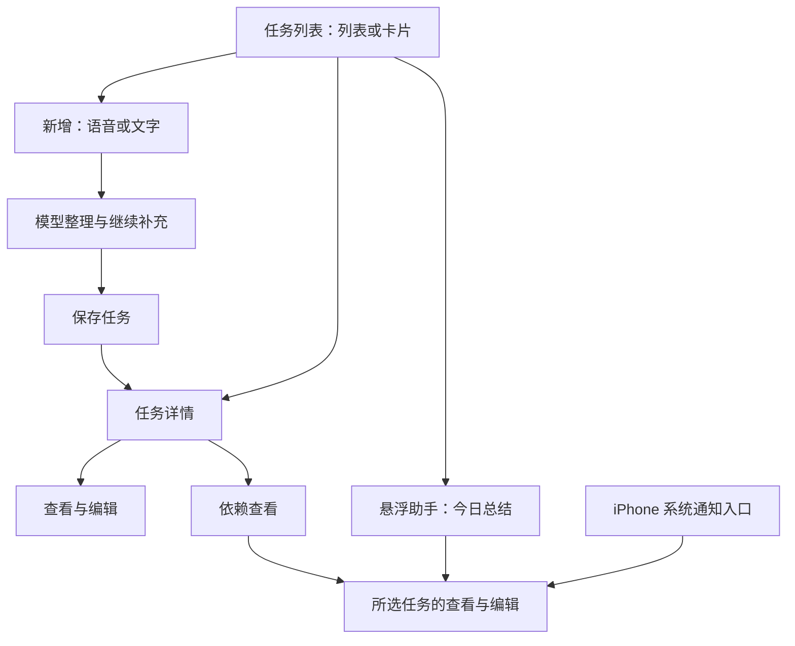

# 任务提醒工具需求

- **工具标识：** `reminders`
- **状态：** 需求梳理稿，完整功能尚未实现
- **版本：** 1.0
- **更新日期：** 2026-10-16
- **所属应用：** Venus Tools（iPhone 与 Apple Watch）

本文是任务提醒工具的正式需求入口，替代原先仅描述提醒同步演示的简版文档。本次只整理需求，不修改应用代码。用户明确提出的要求作为功能基线；文中标注“建议”或“待确认”的内容不视为已经确定的产品规则。

## 1. 目标与范围

把生活中的琐事、计划、目标和想做的事统一记录为任务。用户可以用语音或文字表达，由模型整理为结构化属性，也可以直接手动编辑；随后查找任务、查看依赖、接收提醒，并让悬浮助手总结今天要完成的任务。

### 1.1 已明确的功能

- 任务属性包含标题、概要、Markdown 具体内容、添加时间、执行时间、`key:value` 标签、前置任务、任务等级和是否完成。
- 在任务列表页通过语音或文字添加，支持继续追加信息，模型整理后允许属性缺省。
- 保存新任务后进入该任务详情页。
- 任务提供列表与卡片网格两种展示方式。
- 支持模糊查找、智能查找，以及时间排序、标签、任务等级等过滤。
- 详情页包含“查看与编辑”“依赖查看”两个页签。
- 模型整理与手动编辑作用于同一份任务数据，可以按修改先后相互覆盖。
- 依赖页展示完整依赖链，点击任务节点进入对应任务的查看与编辑页签。
- 提供可拖动的悬浮助手按钮，用于总结今天要完成的任务。
- 首版需要到执行时间主动发送系统通知，并沿用项目的 Apple Watch 提醒方向。
- 任务增加“是否完成”；建议默认未完成。

### 1.2 沿用项目约束

- iPhone 是完整任务管理的主要入口；Apple Watch 承接提醒查看、接收提醒和完成操作。
- 沿用项目已有的本机 AI 方向：语音转写、属性整理、智能查找和今日总结在模型就绪后由 iPhone 本机处理，任务文本与录音不上传云端模型服务。
- 新增的属性抽取、智能检索与总结是否能满足效果、速度要求，需要在开发阶段验证；本文不把已有模型选型视为这些能力已经实现。
- 页面与任务规则、数据保存、AI、通知、同步分开组织，以便后续替换视觉样式和增加其他工具。

项目级背景见 [应用需求](../../需求.md)，现有 AI 约束见 [智能助手工具需求](ai-assistant.md)。模型的具体接入和版本不在本次重新选型。

### 1.3 本轮未要求纳入首版的能力

重复任务、周期提醒、提前多次提醒、自动拆分目标、多人协作、账号系统、云端同步和第三方日历集成均未明确。它们不作为当前验收前提，后续可单独增加需求。

## 2. 文档与代码位置

- 本工具需求：`docs/tools/reminders.md`。
- 工具目录与新增规范：`docs/tools/README.md`。
- 后续本工具代码归属：`VenusTools/Tools/Reminders/`，按 iPhone、Watch 和两端共用内容组织。
- 新工具以同级文档和同级工具代码目录横向添加，不把所有工具堆进同一个页面或业务文件。
- 本次不创建业务代码、不迁移现有原型文件、不调整 Xcode 工程；迁移在正式开发时进行。

## 3. 任务数据

### 3.1 用户可见属性

| 属性 | 含义与编辑方式 | 缺省与校验 |
| --- | --- | --- |
| 标题 | 一句话说明任务；可由模型整理或手动设置 | 建议保存时必填；输入充分时模型可概括标题，否则保留草稿并提示补充 |
| 概要 | 对任务的简短介绍，与具体内容分开 | 可空 |
| 具体内容 | 保存 Markdown 原文，支持阅读渲染与编辑原文 | 可空；切换展示方式不丢失 Markdown 内容 |
| 添加时间 | 任务的添加日期与时间；默认自动填入，也支持手动调整 | 默认当前时间；用于添加时间排序，不用于判断哪次修改更新 |
| 执行时间 | 计划执行的日期与时间；未安排的任务可以留空 | 不得把未提供的时间默认为“现在”；是否支持仅日期及其提醒时刻待确认 |
| 标签 | `key:value` 形式，例如 `领域:生活`、`地点:家` | 默认空集合；建议同一 key 仅有一个 value，不同 key 可并存 |
| 前置任务 | 当前任务依赖的已有任务，可有多个 | 默认无；引用任务身份，不只存标题；不能引用自身或形成循环 |
| 任务等级 | 表达任务的重要程度，和完成状态分开 | 建议“不指定 / 低 / 中 / 高”四档；最终分档与名称待确认 |
| 是否完成 | 用户标记任务是否已经完成 | 建议默认“未完成”；支持切换为“已完成”和恢复为“未完成” |

所有上述属性都应可在详情的“查看与编辑”页签展示和手动设置，包括添加时间。列表、卡片、依赖图、今日总结、通知与 Watch 同步均读取同一份已保存数据。

### 3.2 支撑功能所需的内部信息

这些信息用于保证任务身份与修改一致，不要求用户填写：

- 稳定任务标识：标题修改后仍能找到同一个任务，依赖和通知不会失去关联。
- 最近更新时间与数据版本：用于判断修改先后，以及检测模型处理期间发生的编辑。
- 字段的最近修改信息：避免旧模型结果覆盖用户较新的手动调整。
- 完成时间：用于“今日已完成”等补充展示；恢复为未完成后，如何保留历史可后续定义。
- 通知与同步状态：区分待安排、权限未授予、待同步、失败等状态。

是否保留原始文字、转写文本、录音及完整修改历史，属于待确认的数据保留策略。草稿和处理失败时应保留当前输入，不能因模型失败而丢失。

## 4. 页面结构与主要流程

| 页面或区域 | 主要内容 | 入口与去向 |
| --- | --- | --- |
| 任务列表页 | 列表/卡片切换、查找、过滤、排序、新增入口 | 工具主入口；选择任务后进入详情 |
| 新增区域 | 语音/文字输入、转写、模型整理结果、继续补充、保存 | 从列表页打开；保存成功进入新任务详情 |
| 任务详情：查看与编辑 | 属性展示、Markdown 阅读和编辑、完成开关、语音/文字继续补充 | 从列表、依赖节点、总结结果或通知进入 |
| 任务详情：依赖查看 | 当前任务及完整上下游依赖关系 | 点击节点进入对应任务的“查看与编辑”页签 |
| 悬浮助手 | 今日任务总结、任务入口、刷新 | 从悬浮按钮打开，保留当前浏览上下文 |

新增区域可以采用弹层或独立页面，具体布局在设计阶段确定。任务详情只要求上述两个页签，不额外拆出一套独立的 AI 任务数据页。

原始描述中的编号按以下含义归一：第 4 项是任务列表，第 6 项是详情容器，第 7/8 项是详情页签。“两种方式生成的属性相互覆盖”理解为智能录入与手动编辑相互覆盖。

## 5. 语音、文字添加与继续补充

### 5.1 新建任务

1. 用户在列表页选择语音或文字添加。
2. 语音先转成可编辑文本；文字直接作为整理输入。用户能够查看和修正转写。
3. 模型从输入中整理任务属性；有明确依据的属性才填入，缺少的信息允许缺省。
4. 用户可继续输入文字、补充语音或直接修改整理结果，例如“改到明天下午三点”“标签加上地点：家”“前置任务改成买材料”。
5. 建议保存前展示可编辑的结构化结果，方便核对时间、依赖和等级。
6. 用户保存成功后创建任务并进入详情，默认打开“查看与编辑”页签；保存失败则保留输入和草稿。

首版建议一次新增流程对应一条任务；一句话包含多个独立任务时，不直接静默拆成多条。是否支持批量拆分待确认。

### 5.2 对已有任务继续补充

- 在详情页提供与新增相同的语音/文字补充入口，明确本次正在修改哪一条任务。
- 追加结果更新该任务，保持任务标识不变，不因为追加而另建重复任务。
- “追加”和“替换”根据表达处理：例如“内容再加一句……”追加内容，“把具体内容改为……”替换内容；语义不清时展示待应用结果，不静默清空旧值。
- 用户明确要求清空某个字段时才清空；模型没有输出的字段保持原值。
- 标签的新增、替换和删除，以及前置任务的增减，均需表达为明确变更，不能把“未提及”理解为删除。

### 5.3 抽取与歧义处理

- 相对日期根据输入时的设备本地日期和时区解释，并显示最终日期；例如在 2026-10-16 输入“明天下午三点”，结果显示为 2026-10-17 15:00。
- “周末”“有空时”等无法确定的时间不强行推测成精确时刻；保留原意并提示补充。
- 前置任务必须关联已有任务。名称重名或无法唯一匹配时提供候选，不仅凭相似标题自动关联；找不到时提示选择或后续创建。
- 不允许模型凭空创建前置任务、捏造执行时间，或因为“想做完”就把任务标记为已完成。
- “已经完成”等明确表达可以作为完成属性的待应用变更，并随结果一同展示。
- 首次使用模型、模型未就绪、处理失败和权限被拒绝时显示可理解的状态；仍允许手动录入和编辑任务。

## 6. 同一份数据与覆盖规则

### 6.1 基本原则

- 智能整理和手动编辑是修改同一任务的两种入口，不维护两份相互独立的任务属性。
- 以实际提交并成功保存的修改顺序判断先后，不以可编辑的“添加时间”判断。
- 对同一个字段，较晚提交的明确修改可以覆盖较早的值；无关字段不受影响。
- 新建任务的模型整理结果与手动调整也遵循相同规则；列表等页面显示保存后的统一结果。

### 6.2 模型处理期间发生编辑

模型开始整理时记录所依据的数据版本。结果返回后，先判断相关字段是否在处理期间被用户修改：

- 未发生后续修改：可以展示并应用本次明确变更。
- 同一字段已发生后续修改：不得仅因模型返回较晚就把旧意图当作最新修改。建议展示差异，由用户选择保留当前值或应用模型结果。
- 不同字段发生修改：保留新的手动值，只应用没有冲突的字段。

用户主动确认应用冲突结果后，该操作才成为一次新的修改。自动合并的具体交互仍可在设计阶段调整，但不得静默覆盖较新编辑。

### 6.3 示例

| 顺序 | 操作 | 结果 |
| --- | --- | --- |
| 1 | 语音创建“明天买牛奶”，保存执行时间 | 所有页面显示已保存时间 |
| 2 | 手动把执行时间改为后天 | 新时间覆盖语音生成值 |
| 3 | 文字补充“改成周六上午十点”，确认应用 | 新时间覆盖手动值，其他字段保持原样 |
| 4 | 文字只补充标签 `地点:超市` | 增加标签，执行时间不改变 |
| 5 | 模型处理中，用户又手动改了执行时间 | 旧模型结果不能静默覆盖新编辑 |

## 7. 列表、卡片、查找与过滤

### 7.1 展示

- 列表和卡片网格展示同一组任务，切换后保留查找、过滤及排序条件。
- 两种形式均应能识别标题、概要、执行时间、标签、任务等级和是否完成；未设置的属性使用明确的空值展示，避免伪造信息。
- 任务的“已过执行时间”“前置任务未完成”等提示由数据计算，不额外创造与“是否完成”冲突的任务状态。
- 建议提供直接标记完成的操作；进入详情后仍可查看和调整全部属性。
- 无任务、无匹配结果、加载失败应有不同提示；无匹配结果时可清除过滤条件。

### 7.2 查找与筛选

| 能力 | 行为 |
| --- | --- |
| 模糊查找 | 支持对标题、概要、Markdown 正文文本和标签进行模糊匹配；具体分词与容错方式在实现时选择 |
| 智能查找 | 支持自然语言条件，例如“找下周要办的、和装修有关的重要事情”；返回真实存在的任务，并展示可理解的匹配依据 |
| 添加时间排序 | 支持新到旧、旧到新 |
| 执行时间排序 | 支持早到晚、晚到早；建议未设置时间的任务统一放最后 |
| 标签过滤 | 支持按 key、具体 key:value 筛选；建议不同过滤维度取交集，多标签的“全部满足/任一满足”可切换 |
| 任务等级过滤 | 支持按已定义等级筛选，包括未指定等级 |
| 完成状态过滤 | 支持未完成、已完成、全部；默认展示范围待确认 |
| 时间范围过滤 | 建议支持今天、逾期、未安排以及自定义范围，便于与今日助手衔接 |

- 查找和显式过滤可以组合；智能查找不得静默放宽用户已选条件，应显示最终使用的条件。
- 纯语义查找建议按相关度排列；用户选择添加时间或执行时间排序后，以用户选择为准。
- 排序值相同时，应保持稳定次序；建议使用添加时间和任务标识作为补充规则。
- 模型不可用时，模糊查找、常规过滤和排序仍可使用；智能查找应提示原因并保留输入。

## 8. 任务详情与手动编辑

- “查看与编辑”页签展示第 3 节全部属性；支持手动设置和保存，具体内容支持 Markdown 渲染及原文编辑。
- 编辑执行时间、等级、标签和前置任务时，应提供适合该属性的交互；依赖选择应能区分重名任务。
- 保存成功后，列表、卡片、依赖展示、今日总结和待发送提醒应更新；不要求用户重新创建任务。
- 切换页签或返回时，未保存编辑不得静默丢失；保存/放弃/保留草稿的具体交互在设计阶段确定。
- 完成状态可反复切换。标记完成后撤销尚未发送的该任务提醒；恢复未完成后，根据最新执行时间重新判断安排。
- 前置任务完成不自动把后续任务标记完成；后续任务完成也不自动更改前置任务。
- 删除沿用现有原型已有能力。建议删除前提示依赖影响，删除后清理关联和待发送提醒，并在两端同步，不能残留无效依赖节点。

## 9. 依赖查看

### 9.1 关系含义

- 若任务 B 的“前置任务”包含 A，关系表示为 `A → B`，即 B 依赖 A。
- 一个任务可有多个前置任务，也可被多个后续任务依赖。
- 以当前任务为中心，展示所有递归前置任务以及所有递归后续任务；同时补全这些后续任务的其他前置及其递归前置，显示所有已展示节点之间存在的依赖关系。不把只有一跳的关系当作完整依赖链。
- 例如 `A → B → C` 且 `D → B`，以 A 为中心查看时，也能看到 D，避免遗漏 B 的另一项前置条件；不必因此展开 D 指向其他无关任务的分支。
- 默认不混入与当前任务依赖链无关的任务；是否另设全局任务图可后续讨论。

### 9.2 展示与交互

- 图形应有统一节点样式、清晰层级、明确箭头方向和足够间距，尽量避免文字重叠、连线穿过节点。
- 当前任务突出显示；节点可区分未完成、已完成及尚有未完成前置任务，不能只用颜色区分。
- 节点展示可辨认的标题，必要时补充时间或等级；长标题有完整查看方式。
- 支持拖动画布、缩放及回到当前任务；图较大时可以分段或折叠，但必须能继续展开完整关系，不能静默截断。
- 点击任一任务节点进入该任务的“查看与编辑”页签。建议返回依赖图时保留原浏览位置。
- 无依赖时展示当前任务和清楚的空状态，不显示空白画布。
- 任何入口保存依赖时均拒绝自依赖和间接循环，并指出造成问题的任务链；模型生成的依赖也必须校验。

### 9.3 前置条件的业务影响

前置未完成时至少要能清晰识别。它是否阻止手动完成后续任务、是否影响通知发送，用户尚未明确。首版建议作为提示：不自动改期、不自动完成其他任务，提醒中可注明存在未完成前置任务；最终阻塞规则待确认。

## 10. 系统通知与 Apple Watch

### 10.1 已明确的方向

- 首版需要主动系统通知；具有明确执行日期时间且未完成的任务，保存后安排在执行时间触发的通知。
- 编辑执行时间后撤销旧安排并使用新安排；清空执行时间、标记完成或删除后撤销尚未发送的提醒。
- 恢复未完成时，未来执行时间可以重新安排；过去时间如何补提醒待确认，不应无意重复发送历史通知。
- 未设置执行时间的任务不凭空安排定时通知；如果支持仅设置日期，需要先确定默认提醒时刻。
- 通知点击进入对应任务的“查看与编辑”页签，使用任务标识定位；任务已删除时显示可理解的提示。
- 请求通知权限，说明权限状态；权限被拒绝时仍可管理任务、查看计划和使用今日总结，并提供开启权限的指引。
- 保存任务成功与通知安排成功是不同状态；安排失败时任务仍保留，页面应说明提醒尚未安排并允许恢复处理。

### 10.2 Watch 范围

- 沿用项目方向：查看同步提醒，查看标题、执行时间与是否完成，并支持标记完成及同步回 iPhone。
- iPhone 对任务的新增、修改、完成、恢复和删除，应更新 Watch 对应数据；依赖和标签等完整编辑、依赖图及模型处理先放在 iPhone。
- 需要确定系统通知如何呈现在 Watch：首版建议采用系统允许的 iPhone/Watch 通知呈现方案，避免两端独立安排导致重复提醒；具体方案在开发时验证。
- Watch 不运行模型；未连接时保留最近可用数据，标明待同步，恢复连接后重新尝试，不生成重复任务。
- 两端同时修改同一属性时的版本顺序和时钟差异处理待确定，不把“网络包最后到达”简单当作用户最后修改。
- 系统是否实际展示横幅、声音或在 Watch 上呈现，受权限与设备状态影响；产品应显示真实安排状态，不承诺每条通知必然在两端同时弹出。

### 10.3 仍需定下的通知规则

仅日期任务的提醒时刻、过去时间的补提醒策略、是否允许提前提醒、依赖阻塞是否影响提醒、通知内容隐私、跨时区后的时间含义，以及 Watch 同步时效与冲突策略，见第 13 节。

## 11. 悬浮助手与今日总结

### 11.1 按钮行为

- 任务工具内提供类似助理入口的悬浮按钮，支持拖动；建议在列表和详情页都可使用。
- 按钮应避开主要保存操作、系统安全区域和正在输入的内容，支持拖动结束后吸附边缘；支持不依赖拖拽的无障碍打开方式。
- 点按打开今日总结，拖动不误触打开；是否跨工具全局悬浮、是否记住位置待确认。

### 11.2 今日口径（建议默认，待确认）

- 以设备当前本地日期的零点到次日零点作为“今天”，不按固定 24 小时窗口计算。
- 主区展示执行时间落在今天且未完成的任务。
- 逾期未完成的任务单独提示，不把它们悄悄改成今天；没有执行时间的任务不自动断言“今天必须完成”。
- 已完成任务从今日待办主区移出；可单独显示今日完成情况。
- 今日任务存在未完成前置任务时，提示依赖问题并给出相关任务入口。
- 建议按任务等级组织，再按执行时间排列；具体顺序在等级规则确定后落实。

### 11.3 总结要求

- 先按确定的数据规则筛选真实任务，再让模型归纳，不能仅凭模型记忆决定“今天有哪些任务”。
- 总结至少包含今天待办数量、任务要点、执行时间、重要任务和前置依赖提示；每项可进入对应任务详情。
- 只使用已有任务信息，不凭空添加任务，不声称用户已经完成尚未标记完成的事。
- 任务变更后应重新计算候选任务，并刷新或明确提示总结需要更新，不能把旧结果当作当前结果。
- 没有今日待办时清楚说明；模型不可用或总结失败时，仍展示按同样规则筛选的今日任务清单。
- 总结不自动改变执行时间、任务等级、依赖或是否完成。

## 12. 验收场景

标注“建议规则”的条目在规则确定后转为正式验收。其余条目验证用户已提出的功能以及基本数据一致性。

| 编号 | 场景与操作 | 预期结果 |
| --- | --- | --- |
| TR-01 | 文字输入生活琐事，只说明任务内容 | 模型生成可编辑属性；没有依据的可选属性保持缺省；保存后进入新任务详情 |
| TR-02 | 录制语音，修正转写后继续文字补充 | 补充进入同一草稿；保存为一条任务；语音失败时保留可用输入并可手动继续 |
| TR-03 | 已有任务先手动改时间，再通过文字明确改时间 | 后一次已保存的明确修改覆盖前值；列表、详情、通知安排一致 |
| TR-04 | 模型处理中手动修改同一字段；模型随后返回 | 较新的手动值不被静默覆盖；用户能核对并决定如何应用冲突结果 |
| TR-05 | 只追加标签，或明确清空概要 | 前者不改变时间和正文；后者只清空指定字段，未提及字段不变 |
| TR-06 | 手动设置全部用户可见属性并编辑 Markdown | 可修改并保存全部属性，包括添加时间与是否完成；Markdown 原文和阅读展示对应 |
| TR-07 | 在列表/卡片之间切换，并组合搜索、标签、等级、完成状态与时间排序 | 两种视图显示同一结果；条件保留；排序和空值处理符合最终规则 |
| TR-08 | 关键词近似匹配，或输入自然语言智能查找 | 返回可进入详情的真实任务；智能查找可解释条件；模型不可用时常规查找可继续 |
| TR-09 | 建立 A→B→C，B 另依赖 D，C 又有后续任务 | 以 B 为中心可查看完整上游与下游；以 A 为中心仍可看到 B 的另一前置 D；节点、层级和箭头可辨；点击 C 打开 C 的编辑页签 |
| TR-10 | 尝试 A 依赖自身，或在已有 A→B→C 后让 A 依赖 C | 拒绝保存非法关系并指出原因；原关系不损坏；模型与手动入口一致 |
| TR-11 | 未完成任务设定未来执行时间，随后修改时间、标记完成、恢复或删除 | 按最新数据更新待发送通知；完成/删除撤销旧安排；恢复后的处理按时间规则执行 |
| TR-12 | 通知权限被拒绝或通知安排失败 | 任务保存且可继续编辑；明确显示通知状态；不宣称提醒已就绪 |
| TR-13 | 从可用的任务通知打开应用 | 定位对应任务并打开查看与编辑；任务已删除时有明确提示 |
| TR-14 | iPhone 更新任务，Watch 标记完成，短暂断开后重连 | 按最终同步规则收敛到同一任务状态，保留离线数据，不生成重复项，完成状态影响未发送提醒 |
| TR-15 | 拖动助手按钮并打开今日总结 | 按钮可移动且点按/拖动可区分；总结可跳转任务，未擅自修改任务 |
| TR-16 | 存在今日、逾期、未安排和已完成任务（建议规则） | 今日待办只按确认口径计入；逾期和依赖问题单独提示；模型失败仍有今日清单 |
| TR-17 | 模型已就绪后断网，执行新增整理、智能查找和今日总结 | 本机处理可用；模型效果按实现阶段样本验证，任务内容和录音不上传云端模型服务 |
| TR-18 | 保存后退出并重新打开应用 | 已保存任务及属性、完成状态、依赖仍保留；通知和同步状态可恢复检查 |

## 13. 待确认决策

以下项目先记录，不阻碍本次需求文档落地。正式开发涉及相应行为前应确定。

| 项目 | 当前建议或需要回答的内容 |
| --- | --- |
| 任务等级 | 是否采用“不指定 / 低 / 中 / 高”；是否需要紧急程度作为独立维度 |
| 标题与缺省 | 保存时是否要求非空标题；其他属性允许缺省的范围；是否完成默认未完成 |
| 日期语义 | 执行时间是否同时支持仅日期与精确时刻；跨时区后保持当地钟点还是同一绝对时刻 |
| 通知时刻 | 仅日期任务何时提醒；新建/恢复为过去执行时间时是否补发；是否需要提前提醒 |
| 通知隐私 | 锁屏与 Watch 是否展示标题、概要等内容，用户是否可隐藏 |
| 依赖影响 | 未完成前置任务是否阻止后续完成或通知；是否只提示，不强制限制 |
| 今日总结 | 是否采用第 11 节建议口径；逾期是否计入“今天要做”，是否显示未安排任务 |
| 默认列表 | 默认显示全部还是仅未完成；默认排序和是否记住列表/卡片模式 |
| 标签 | 是否按单 key 单 value 管理；是否需要多值、建议标签和标签字典 |
| 保存与追加 | 整理结果是否确认后保存；多任务输入是否拆分；是否需要撤销和历史恢复 |
| 删除 | 删除被依赖任务时，解除关联、禁止删除或采用其他交互；是否需要回收站 |
| Watch | 可查看的任务范围和属性、同步时效、离线修改与双端冲突处理、通知呈现方案 |
| 助手范围 | 只在本工具内悬浮，还是在整个应用内悬浮；是否记住位置 |
| 数据保留 | 是否保存原始文字、语音转写、录音、完成历史与修改历史，以及删除方式 |
| AI 验证 | 抽取、语义检索和总结的样本集、可接受耗时、输入长度与失败恢复标准 |

## 14. 现有原型与后续开发边界

仓库目前只有简单提醒原型：标题、时间、完成状态、iPhone 新增/完成/删除，以及通过 WatchConnectivity 同步到 Apple Watch 并标记完成。它以最后到达的完整列表快照更新，不解决同时编辑冲突，也没有安排本地通知。

本需求中的 Markdown 内容、标签、任务等级、依赖图、AI 属性整理、智能查找、悬浮助手、正式通知与冲突处理，均不能视为现有原型已经支持。正式实现时应说明旧提醒如何映射到新任务，至少保留标题、时间和完成状态；旧用户数据迁移策略随数据方案确定。

后续建议按“数据与手动任务流程 → 语音/文字整理 → 查找与过滤 → 依赖图 → 通知与 Watch 一致性 → 今日助手”的顺序细化设计和实现；具体排期另行制定。
